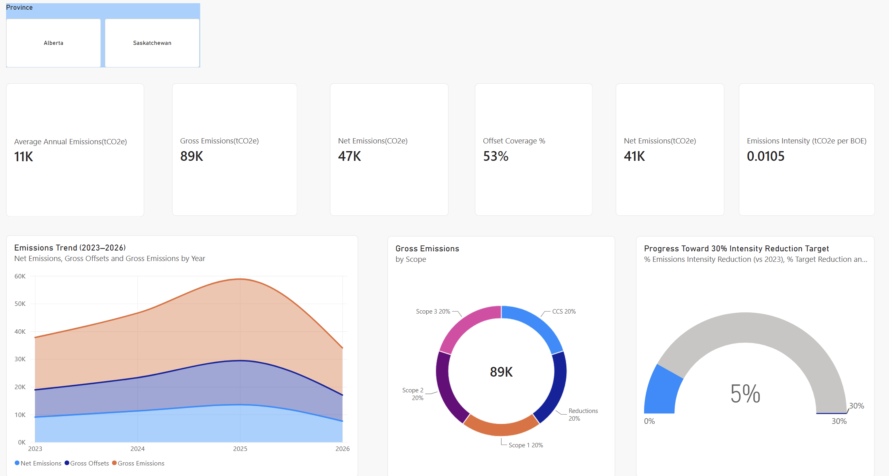
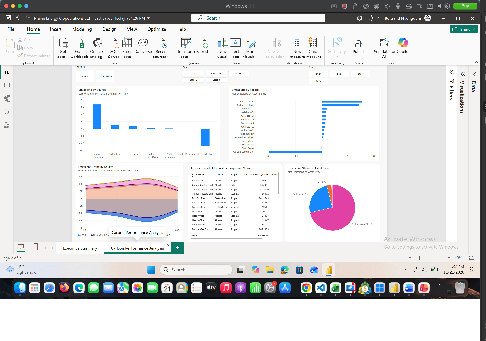

# Prairie Energy Carbon Dashboard

**Repository:** [github.com/nkongdem/Prairie-energy-carbon-dashboard](https://github.com/nkongdem/Prairie-energy-carbon-dashboard)

An interactive Power BI dashboard and analytics pipeline for tracking greenhouse gas emissions, carbon offsets, and progress toward an emissions-intensity reduction target at a multi-province energy operator.

## Overview

Prairie Energy Operations Ltd. (PEO) operates production, processing, and fleet assets across Alberta and Saskatchewan. This project builds a full carbon data model from raw utility, production, and emissions-estimate data, then surfaces it as a two-page executive dashboard that tracks performance against PEO's public commitment to **reduce GHG emissions intensity by 30% over five years**.

## What it does

- **Builds a clean data model** from raw Excel source data (utility meters, production volumes, emission-factor tables, fugitive/fleet/commuting estimates) using Power Query, including fixes for mismatched meter columns, blank padding rows, and unit conversions (GJ ↔ m³, kWh ↔ tCO2e).
- **Classifies every emission source** into GHG Protocol Scope 1/2/3, plus custom CCS and Reductions categories, each independently verified against Government of Canada emission-factor tables.
- **Calculates key metrics** via DAX: Gross Emissions, Gross Offsets, Net Emissions, Average Annual Net Emissions, Emissions Intensity (tCO2e/BOE), Offset Coverage %, and progress toward the five-year intensity target.
- **Visualizes performance** across two dashboard pages:
  - **Executive Summary** — KPI cards, a multi-year emissions trend, a Scope/CCS/Reductions breakdown, and a gauge tracking real-time progress toward the 30% intensity-reduction commitment.
  - **Carbon Performance Analysis** — emissions by source, facility, and asset type, a detailed drill-through table, and year/scope/province filtering.

## Dashboard

**Executive Summary**



**Carbon Performance Analysis**



## Key findings

- Net emissions (~41,000 tCO2e) sit comfortably under the 100,000-tonne OBPS regulatory reporting threshold.
- Existing CCS and solar offsets cover 53% of gross emissions, but emissions intensity has only improved ~4.6% against a 30% five-year target — roughly 15% of the distance needed.
- Saskatchewan operations have **no CCS or solar offset capacity**, and now contribute more net emissions than the larger Alberta operation as a result — the clearest identified opportunity for closing the target gap.
- Processing assets (gas plants) account for over 70% of net emissions by asset type, concentrating the footprint in a small number of facilities.

## Contents

```
├── Prairie Energy Oppoerations Ltd.pbix    # Power BI dashboard (data model, measures, visuals)
├── ENVS019_PEO_Data.xlsx                   # Raw source data
├── Executive summary Insights.pptx         # Executive Insights Report deck
├── screenshots/                            # Dashboard page screenshots (shown above)
└── README.md
```

## Tools

- **Power BI Desktop** — data modeling, DAX measures, dashboard visuals
- **Power Query (M)** — source data cleaning, transformation, and merging
- **Excel** — raw data source
